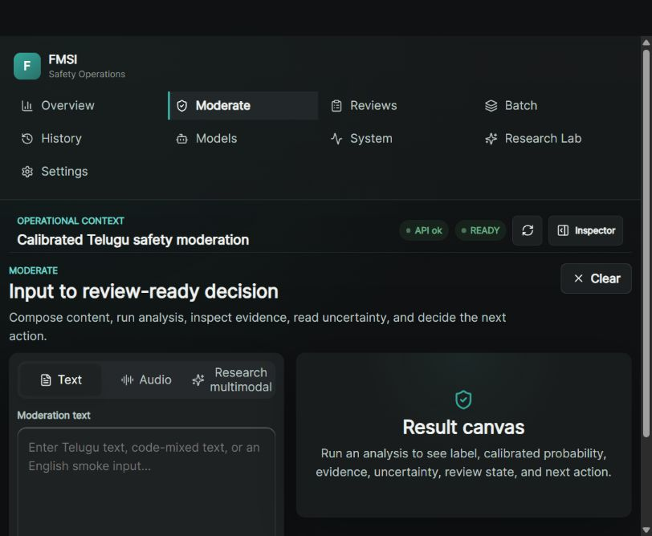
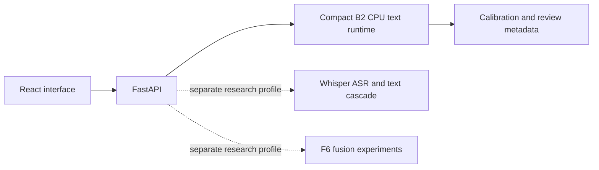
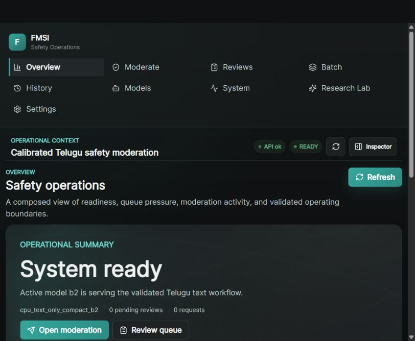
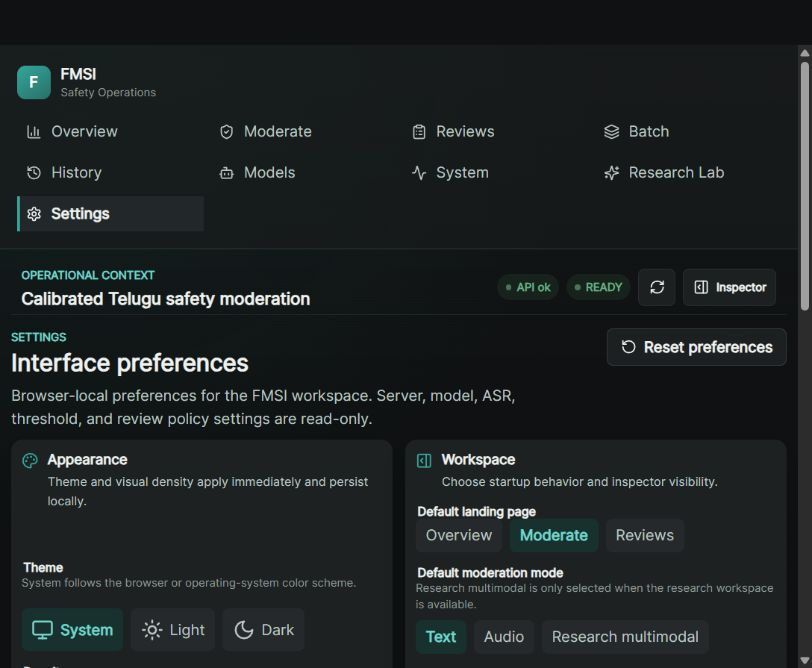

# FMSI — Frugal Multimodal Safety Intelligence

**Telugu-first safety research with compact CPU text inference, calibrated review metadata and a clear boundary around speech and multimodal experiments.**

I built FMSI to investigate what a constrained safety system can support honestly: compare baselines and deep models, investigate class imbalance, preserve a compact text decision boundary, measure calibration and make uncertain cases reviewable. The default validated core is text-only. Speech and multimodal work remain research-only.

The saved compact-runtime test matched **10,542 / 10,542 labels**. A conservative selective policy sent approximately **87.41%** of test examples to human review. Those results describe different tests; neither establishes autonomous moderation quality or commercial clearance.

## Problem and technical difficulty

Safety labels are imbalanced, language/domain coverage is narrow, probabilities need calibration and deployment cost matters. A more complex model can underperform a simple baseline, while synthetic audio can create misleading multimodal gains. Dataset availability does not settle source-text or redistribution rights.

## What I built

A Python/FastAPI inference service, React interface, classical/deep-model comparison and imbalance investigations, calibration and selective-review workflows, compact text runtime, deployment profiles, model/data cards and evidence-indexed reproduction material. Research experiments include ASR and multimodal fusion; these are not promoted to the default core.

## System architecture

[Architecture and key decisions](ARCHITECTURE.md) explains implemented profile separation.

## Engineering depth and key decisions

- Retained the character TF-IDF/logistic baseline rather than selecting a deep model for appearance.
- Investigated class imbalance and model comparisons before keeping the selected boundary.
- Added calibrated-risk metadata without silently replacing the original classification boundary.
- Used compact float32 packaging with saved label-equivalence evidence.
- Separated the lightweight core image from heavy speech dependencies and kept multimodal confounding explicit.

## Verified results and context

| Saved evidence | Result | Interpretation |
| --- | --- | --- |
| Compact label-equivalence test | 10,542 / 10,542 matched | Specific saved comparison, not all possible inputs |
| Compact artifact | Approximately 1.263 MiB | Model/runtime artifact, not complete deployment size |
| Local batched inference | Approximately 0.098 ms p50 per item | Batch benchmark, **not API, network or production latency** |
| Calibration | Brier approximately 0.0077; ECE approximately 0.0040 | Specific saved benchmark, not a universal probability guarantee |
| Selective policy | Approximately 87.41% human review | Review workload, **not model accuracy** |

Methods, source-origin hashes and exact values are in [bounded results](evidence/results.json) and the [evidence guide](EVIDENCE.md). These historical numerical results were not retrained or rebenchmarked during export preparation.

## Validation evidence

Saved release evidence records core/research Docker smoke, build, tests and reproduction gates. This preparation reran five lightweight metrics/schema/reproducibility tests successfully; it did not rerun every application test or clear dataset/model rights. [Validation scope](VALIDATION.md).

## Representative screenshots

These are interface states, not proof of completed inference or deployment. [Screenshot review](SCREENSHOT_REGISTER.md).

## Setup / reproduction boundary

This export contains documentation, selected UI captures and aggregate evidence only. There is no install command that makes the original inference system runnable from this tree. Original reproduction requires separately authorized source, compatible Python dependencies and permitted model/data access. No weights, inputs or raw datasets are supplied. Saved clean-core reproduction reported a scikit-learn saved-artifact version warning; that warning is not hidden. [Reproduction boundary](REPRODUCIBILITY.md).

## Hardware / resource context

The selected text path is CPU-oriented. Historical local batching and artifact measurements are specific to their saved environment; they are not a cross-device SLA. The research profile includes heavy PyTorch/speech dependencies and is materially larger than the core. A core image comparison recorded 94.28% reduction against its earlier profile; CLI and image-inspect sizes use different conventions.

## Limitations

Validated lineage is Telugu benchmark research. English executes but is unvalidated. Speech quality is limited; real paired safety-audio validation is missing. Multimodal gain is confounded by synthetic audio. Automatic selective coverage is low. No human equivalence, regulatory certification, customer deployment, robust multilingual safety or commercially clean bundled model is claimed. The manuscript is a draft, not a peer-reviewed publication.

## Provenance / redistribution and intentional exclusions

Source licensing and B2 lineage remain unresolved. Raw Telugu datasets, MuRIL/Distil-mBERT and other checkpoints, FLEURS archives, WAV collections, SQLite stores, review/input history, logs, environments and unclear weights are intentionally excluded. The commercial-runtime software boundary does not make the research model commercially clean.

## Project status and publication scope

The engineering project is complete within the bounded scope described here. This staged repository is a **case study and evidence summary**, not a runnable source distribution. No source license is selected or granted by these documents. Publication is awaiting owner review. See [source-release decision](SOURCE_RELEASE_DECISION.md), [provenance](PROVENANCE.md), [validation](VALIDATION.md) and [file manifest](PUBLIC_EXPORT_MANIFEST.json).
